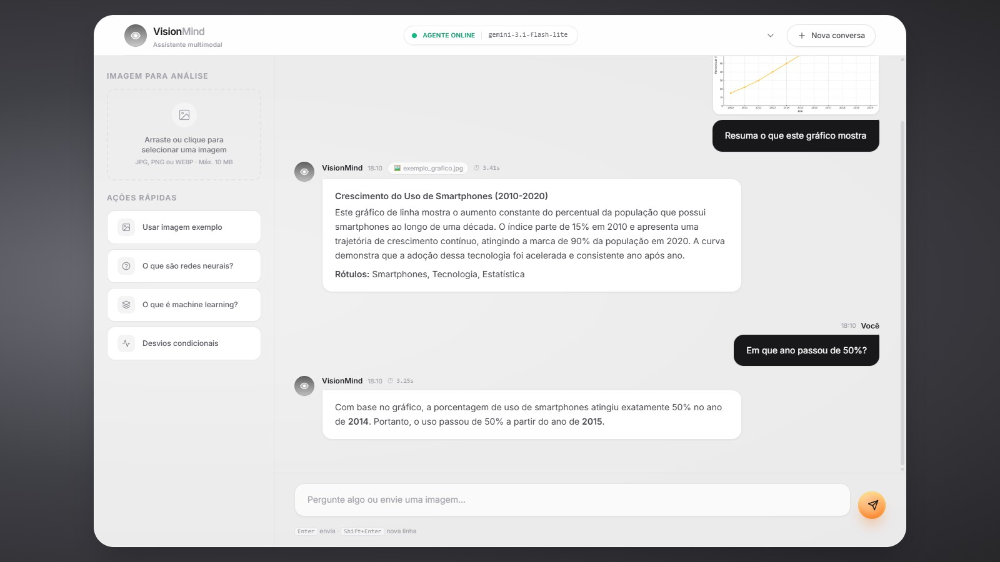

# 🧠 VisionMind

Assistente multimodal desenvolvido com **Python, LangChain e Google Gemini**, capaz de analisar imagens, responder perguntas, explicar conceitos e utilizar ferramentas inteligentes através de um agente orquestrador.

---

## 📸 Interface

### Tela Principal


### Conversa com análise de imagem

O assistente responde perguntas sobre a imagem enviada e lembra do contexto nas mensagens seguintes:



---

## 🚀 Funcionalidades

- 🤖 Assistente conversacional com **memória da conversa** (últimas 6 trocas)
- 🖼️ Análise de imagens com Gemini Vision, respondendo **perguntas específicas** sobre a imagem
- 🧠 Explicação de conceitos e conteúdos
- 🔧 Agente Orquestrador (ReAct) com LangChain, que escolhe a ferramenta certa para cada pergunta
- 📤 Upload de imagens **JPG, PNG ou WEBP** (até 10 MB), com validação no servidor
- 📋 Botão para copiar as respostas
- 🌐 Aplicação Web responsiva (desktop e celular)
- 💻 Modo terminal (`main.py`)

---

## 🏗️ Arquitetura

```text
Usuário
   ↓
Frontend (HTML + JavaScript)
   ↓
Servidor Python (histórico por conversa)
   ↓
Agente Orquestrador (ReAct)
   ↓
 ┌─────────────────────────┐
 │ Ferramenta Explicadora  │
 └─────────────────────────┘

 ┌─────────────────────────┐
 │ Ferramenta Analisadora  │
 │ de Imagens              │
 └─────────────────────────┘
   ↓
Google Gemini
```

---

## 🛠️ Tecnologias

### Backend

- Python 3.12
- LangChain
- Google Gemini
- Pillow
- ThreadingHTTPServer (biblioteca padrão do Python)

### Frontend

- HTML5
- Tailwind CSS
- JavaScript

### IA

- Gemini Flash (`gemini-3.1-flash-lite`)
- Gemini Vision

---

## ⚙️ Instalação

### Requisitos

- Python 3.12 (versão testada)
- Uma chave da API do Gemini, que pode ser gerada no [Google AI Studio](https://aistudio.google.com/apikey)

### Clonar repositório

```bash
git clone https://github.com/GuiMRDS/Vision_Mind.git
cd Vision_Mind
```

### Criar ambiente virtual

Windows:

```bash
python -m venv .venv
.venv\Scripts\activate
```

Linux/Mac:

```bash
python3 -m venv .venv
source .venv/bin/activate
```

### Instalar dependências

```bash
pip install -r requirements.txt
```

---

## 🔑 Configuração

Crie um arquivo `.env` na raiz do projeto:

```env
GEMINI_API_KEY="SUA_CHAVE"
```

Para trocar o modelo usado, edite `my_models.py`.

---

## ▶️ Executando

### Interface Web

```bash
python server.py
```

Acesse:

```text
http://localhost:8000
```

Por padrão o servidor só aceita conexões do próprio computador. Para usar outra porta ou abrir na rede local:

```bash
python server.py 8080
python server.py --host 0.0.0.0   # qualquer pessoa na rede poderá usar sua chave
```

Imagens enviadas pela interface ficam em `imagem/` e são apagadas automaticamente depois de 24 horas.

### Terminal

```bash
python main.py
```

---

## 💡 Exemplos de uso

- Envie uma imagem e pergunte: *"Qual ano teve o maior valor neste gráfico?"*
- Na mensagem seguinte, sem reenviar a imagem: *"E qual foi o menor?"*
- *"Explique o que são redes neurais"*
- *"Faça uma análise da imagem exemplo_grafico.jpg"*

---

## 🧪 Testes

Testes automatizados (não acessam a internet nem gastam cota da API):

```bash
python -m unittest discover -s testes -t . -p "test_*.py"
```

Scripts manuais que chamam o Gemini de verdade:

```bash
python -m testes.listar_modelos
python -m testes.teste_modelos
```

---

## 📄 Licença

Este projeto está sob a licença MIT.
