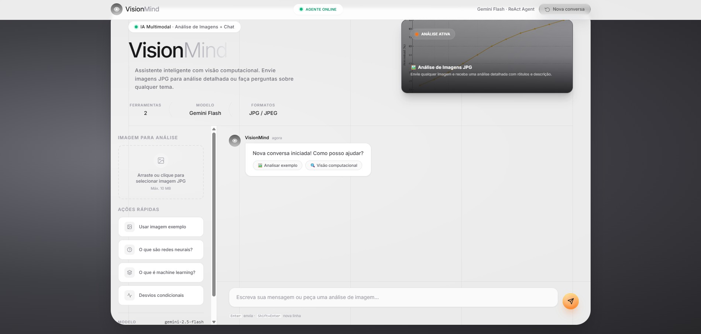

# 🧠 VisionMind

Assistente multimodal desenvolvido com **Python, LangChain e Google Gemini**, capaz de analisar imagens, responder perguntas, explicar conceitos e utilizar ferramentas inteligentes através de um agente orquestrador.

---

## 📸 Interface
<<<<<<< HEAD

### Tela Principal

=======
>>>>>>> 7ccf89ae23d06d6a758badb87ffa747001aa282a


---

## 🚀 Funcionalidades

- 🤖 Assistente conversacional
- 🖼️ Análise de imagens com Gemini Vision
- 🧠 Explicação de conceitos e conteúdos
- 🔧 Agente Orquestrador com LangChain
- 📤 Upload de imagens (JPG, PNG, WEBP · até 10 MB) com validação no servidor
- 🌐 Aplicação Web responsiva
- 📡 Comunicação Frontend ↔ Backend

---

## 🏗️ Arquitetura

```text
Usuário
   ↓
Frontend (HTML + JavaScript)
   ↓
Servidor Python
   ↓
Agente Orquestrador
   ↓
 ┌─────────────────────────┐
 │ Ferramenta Explicadora  │
 └─────────────────────────┘

 ┌─────────────────────────┐
 │ Ferramenta Analisadora  │
 │ de Imagens              │
 └─────────────────────────┘
   ↓
Google Gemini
```

---

## 🛠️ Tecnologias

### Backend

- Python
- LangChain
- Google Gemini
- Pillow
- HTTPServer

### Frontend

- HTML5
- Tailwind CSS
- JavaScript

### IA

- Gemini Flash
- Gemini Vision

---

<<<<<<< HEAD
## ✨ Melhorias Implementadas

### Interface

- Header reorganizado
- Hero otimizado
- Redução de espaços vazios
- Melhor aproveitamento vertical da tela
- Layout inspirado em ChatGPT, Claude e Gemini
- Campo de mensagem sempre acessível
- Responsividade aprimorada

### Backend

- Correção do carregamento de imagens
- Compatibilidade entre:

```text
imagem/
site/imagem/
```

- Uso de caminhos absolutos
- Melhor tratamento de erros
- Integração completa com o agente LangChain

---

## 📂 Estrutura do Projeto

```text
VisionMind/
│
├── agente/            # Agente orquestrador (ReAct) e modelo Pydantic
├── ferramentas/       # Ferramenta Analisadora de Imagem e Ferramenta Explicadora
├── estudos/           # Chain de análise de imagem isolada (python -m estudos.lang_chain)
├── imagem/            # Imagens do projeto + uploads (uploads ignorados pelo git)
├── site/
│   ├── index.html     # Interface web (HTML + Tailwind + JS)
│   └── imagem/
├── testes/            # Scripts avulsos para testar modelos/SDK
│
├── main.py
├── server.py
├── my_helper.py
├── my_keys.py
├── my_models.py
├── requirements.txt
└── .env
```

---

=======
>>>>>>> 7ccf89ae23d06d6a758badb87ffa747001aa282a
## ⚙️ Instalação

### Clonar repositório

```bash
git clone https://github.com/SEU-USUARIO/VisionMind.git
cd VisionMind
```

### Criar ambiente virtual

Windows:

```bash
python -m venv .venv
.venv\Scripts\activate
```

Linux/Mac:

```bash
python3 -m venv .venv
source .venv/bin/activate
```

### Instalar dependências

```bash
pip install -r requirements.txt
```

---

## 🔑 Configuração

Crie um arquivo `.env`:

```env
GEMINI_API_KEY="SUA_CHAVE"
MARITACA_API_KEY="SUA_CHAVE"
```

---

## ▶️ Executando

### Interface Web

```bash
python server.py
```

Acesse:

```text
http://localhost:8000
```

### Terminal

```bash
python main.py
```

---

## 📄 Licença

Este projeto está sob a licença MIT.
